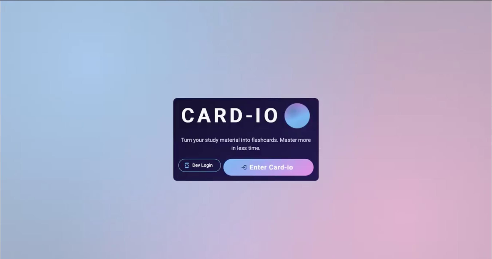
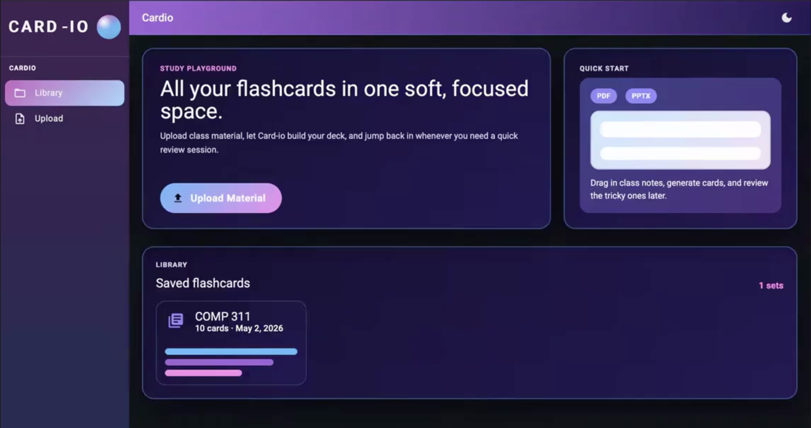
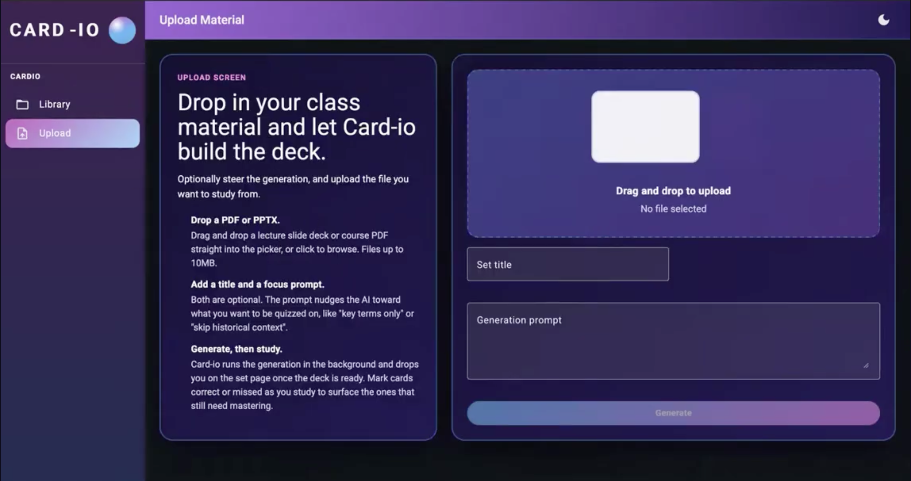
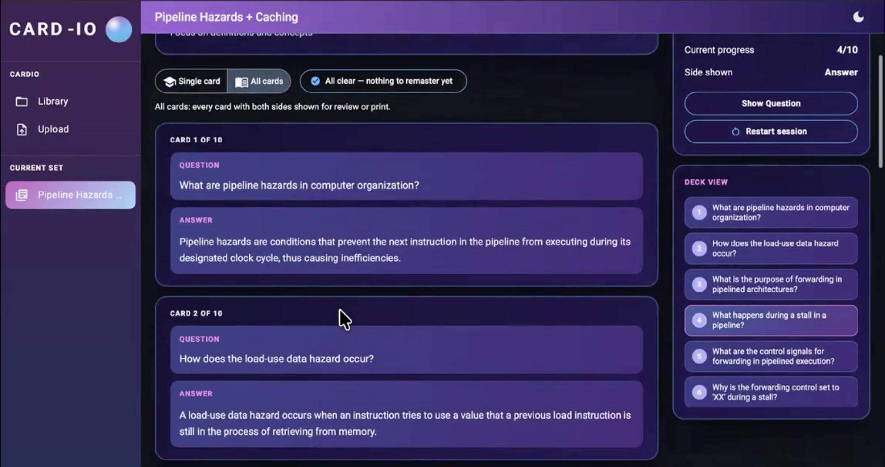
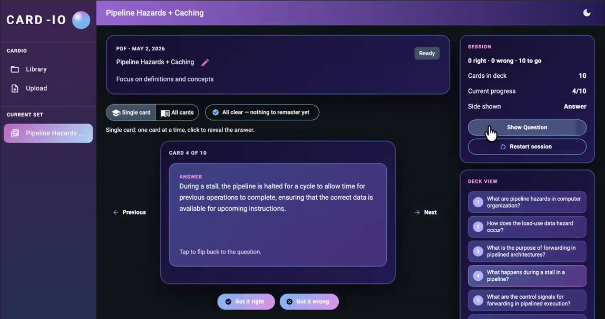
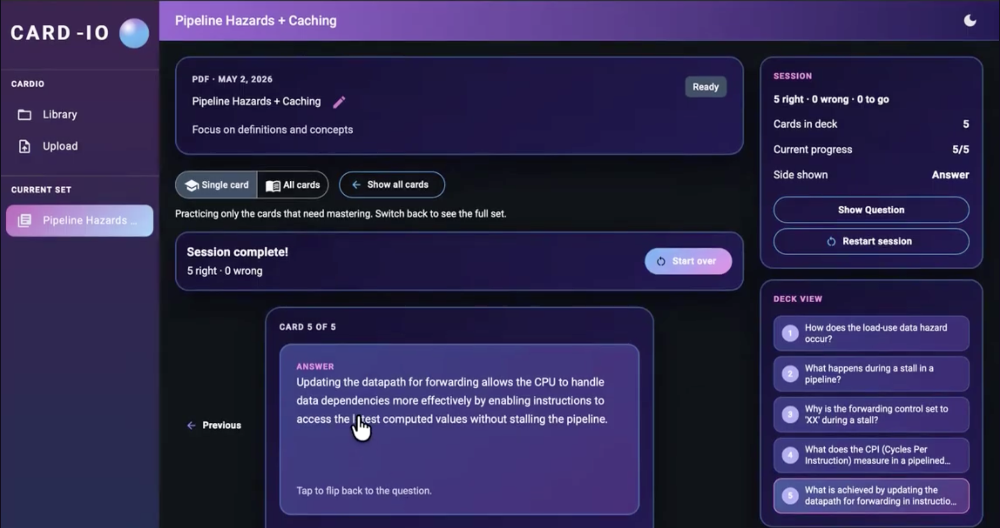

# Cardio: AI flashcards from your course materials

[![Gabrielle's LinkedIn][g-linkedin-shield]][gabrielle-linkedin-url]

Cardio turns lecture slides and reading PDFs into study-ready flashcard decks, then tracks which cards a student keeps missing and builds practice sessions around them. A four-person team built it for UNC Chapel Hill's Foundations of Software Engineering course (COMP 423, Spring 2026).

**My part:** I built the part of Cardio that tracks what a student knows and turns it into targeted practice, from the data behind it to the study screens. I also tuned how the AI writes the flashcards and refined the interface.

### Demo video

## The problem

Making flashcards by hand from dense slides and chapter PDFs takes time that could go to studying. Cardio builds the deck from the material itself, so study time goes to active recall (testing yourself instead of rereading) on the cards a student actually struggles with.

## What it does

<table>
  <tr>
    <td width="33%" valign="top">
       
      <b>Landing page.</b> Light and dark themes, with a clear path to upload or open the library.
    </td>
    <td width="33%" valign="top">
       
      <b>Library.</b> Every set in one grid, with inline rename and delete with confirmation.
    </td>
    <td width="33%" valign="top">
       
      <b>Upload.</b> Drag and drop a PDF or PowerPoint, name the set, and optionally add a prompt such as "focus on definitions." Progress updates live, and a failure shows a clear message.
    </td>
  </tr>
  <tr>
    <td width="33%" valign="top">
       
      <b>Deck views.</b> Flip through one card at a time or see the whole deck on one screen.
    </td>
    <td width="33%" valign="top">
       
      <b>Study session.</b> Progress ("Card 5 of 20"), correct and missed buttons with undo, and a running score for the session.
    </td>
    <td width="33%" valign="top">
       
      <b>Practice mode.</b> Builds a session from only the cards a student still needs to master. A correct answer forgives an earlier miss, so the list reflects what they struggle with now.
    </td>
  </tr>
</table>

## How it works

An Angular frontend calls a layered FastAPI backend (routes, services, repositories) backed by PostgreSQL through SQLModel, and automated checks enforce full test coverage of the backend. Uploads go to a background job that extracts text from the PDF or slides and asks an OpenAI language model (GPT-4o mini, via Azure) to return structured flashcards, while the frontend shows progress until the deck is ready.

## My role

- **Planning.** Performance tracking, which records what a student gets right or wrong, began as a stretch goal that I pushed for and drove to completion. I wrote its second-sprint requirements as tracked tasks.
- **Performance tracking API.** Students mark each card correct or missed, with undo. Each card keeps running counts, updated atomically (two requests at once can't overwrite each other), and a mastery filter returns only new, missed, or mastered cards.
- **Study and practice views (Angular).** The study session, the "practice cards that need mastering" mode, and the single-card and all-cards deck views, all wired to the tracking API.
- **Per-session score.** I proposed and added a live tally ("5 right, 0 wrong, 0 to go") so a student sees how today's session went, not only lifetime totals.
- **AI card generation.** I tested generation across repeated runs and different documents, then improved it for consistency, speed, and longer documents:
  - Rewrote the prompt with rules (one fact per card, answers grounded in the uploaded text) and worked examples.
  - Added structured output (a strict JSON schema, so every response has the same shape). Failures now show a clear error instead of silently falling back to weaker cards.
  - Let the model read more than four times as much of a long document, and stopped padding short documents with filler cards.
  - Added timing logs and a faster default model.
- **Interface.** Teammate Kennedy created the base design. I extended it with drag-and-drop upload and refined it with gradients that hold up in light and dark mode, highlights, and centered, well-grouped layouts.
- **Backend and teamwork.** API models (the data shapes the app validates), set listing, and an authenticated upload service so users can only reach their own sets, plus automated tests. I also reviewed teammates' pull requests (proposed code changes) and helped fix their development environments.

## Decision, status, and what's next

**Decision.** I chose simple running totals of right and wrong answers for each card over a full per-user history: they give students the one signal they need, which cards to practice, in a feature small enough to test thoroughly.

**Status.** Deployed on the course platform and demoed to classmates and instructors after each of two sprints. Their feedback confirmed students wanted performance tracking and asked for full slide decks and for reading content inside slide images. I widened how much of a document the model reads in response.

**Limits.** Files are capped at 10 MB, text inside images is not read, counts are lifetime totals per card, and a study session restarts if you leave it. Cards were refined through repeated test runs on different documents but not formally evaluated, and generated cards can contain errors, so students should check them against their materials.

**Next.** Reading text and exercises inside slide images, a higher file size limit, per-user history over time, saved sessions, and sorting cards by performance. Open questions: how consistent are cards across runs of the same document, and do they vary in accuracy by subject or by how a student words the focus prompt?

### Built With

[![Angular][Angular]][Angular-url]
[![TypeScript][TypeScript]][TypeScript-url]
[![FastAPI][FastAPI]][FastAPI-url]
[![Python][Python]][Python-url]
[![PostgreSQL][PostgreSQL]][PostgreSQL-url]
[![OpenAI][OpenAI]][OpenAI-url]
[![Docker][Docker]][Docker-url]
[![GitHub Actions][GitHubActions]][GitHubActions-url]

## Team

Kennedy, Aniqa, Shruti, and me (Gabrielle).

## About this page

I used AI coding assistants (GitHub Copilot and Claude) as a pair, not an autopilot, and reviewed their output before merging. Source code is not public because this is a course and team project.

(<a href="#readme-top">back to top</a>)

<!-- MARKDOWN LINKS & IMAGES -->
[g-linkedin-shield]: https://img.shields.io/badge/linkedin-gabrielle-white?style=for-the-badge&logo=linkedin&labelColor=%230A66C2
[gabrielle-linkedin-url]: https://linkedin.com/in/gabrielleestewart
[Angular]: https://img.shields.io/badge/angular-%23DD0031?style=for-the-badge&logo=angular&logoColor=white
[Angular-url]: https://angular.dev
[TypeScript]: https://img.shields.io/badge/typescript-%233178C6?style=for-the-badge&logo=typescript&logoColor=white
[TypeScript-url]: https://www.typescriptlang.org
[FastAPI]: https://img.shields.io/badge/fastapi-%23009688?style=for-the-badge&logo=fastapi&logoColor=white
[FastAPI-url]: https://fastapi.tiangolo.com
[Python]: https://img.shields.io/badge/python-%233776AB?style=for-the-badge&logo=python&logoColor=white
[Python-url]: https://www.python.org
[PostgreSQL]: https://img.shields.io/badge/postgresql-%23336791?style=for-the-badge&logo=postgresql&logoColor=white
[PostgreSQL-url]: https://www.postgresql.org
[OpenAI]: https://img.shields.io/badge/openai-%23412991?style=for-the-badge&logo=openai&logoColor=white
[OpenAI-url]: https://openai.com
[Docker]: https://img.shields.io/badge/docker-%232496ED?style=for-the-badge&logo=docker&logoColor=white
[Docker-url]: https://www.docker.com
[GitHubActions]: https://img.shields.io/badge/github%20actions-%232088FF?style=for-the-badge&logo=githubactions&logoColor=white
[GitHubActions-url]: https://github.com/features/actions
